<h1 align="center" style="border-bottom:none">Hi there, I'm Ryan  👋</h1>

  
  
  
  

<h2 style="border-bottom:none">About Me</h2>

Statistics student building backend systems, data workflows, and practical AI applications. I enjoy turning real-world problems into simple, reliable, and useful software.

Currently focused on backend engineering, data infrastructure, automation, and quantitative applications.

- **Background:** B.Sc. in Statistics.
- **Building:** Open-source tools, automation systems, data workflows, and practical products.
- **Interests:** Systems design, data infrastructure, algorithmic trading, and quantitative applications.

<h2 style="display:inline;border-bottom:none;margin-bottom:0;padding-bottom:0">Tech Stack & Tools</h2> <i>(click to expand)</i>

 

  <h3>Languages</h3>
  

    
    
    
    
    
    
  

  <h3>Data, Backend &amp; AI</h3>
  

    
    
    
    
    
    
    
    
    
  

  <h3>Web, Systems &amp; Tools</h3>
  

    
    
    
    
    
    
    
    
  

<h2 style="display:inline;border-bottom:none;margin-bottom:0;padding-bottom:0">Projects</h2> <i>(click to expand)</i>

 

  **Products & Tools**

  - [**VisuaSlide**](https://github.com/ryantr-statinops/VisuaSlide)
  - [**InfoBoard**](https://github.com/ryantr-statinops/InfoBoard)
  - [**ScrawlNews**](https://github.com/ryantr-statinops/ScrawlNews)
  - [**Orbit-System-Manager**](https://github.com/ryantr-statinops/Orbit-System-Manager)

  **Quant Lab**

  - [**factorsbt**](https://github.com/ryantr-statinops/factorsbt)
  - [**lattice-terminal**](https://github.com/ryantr-statinops/lattice-terminal)
  - [**fundamental-ranking-lab**](https://github.com/ryantr-statinops/fundamental-ranking-lab)
  - [**qlab_policy**](https://github.com/ryantr-statinops/qlab_policy)
  - [**indexpilot-us100**](https://github.com/ryantr-statinops/indexpilot-us100)

<h2 style="border-bottom:none">GitHub Analytics</h2>

<table width="100%">
<tr valign="top" align="center">
<td width="50%">

</td>

<td width="50%">

 

</td>
</tr>
</table>

 

  

